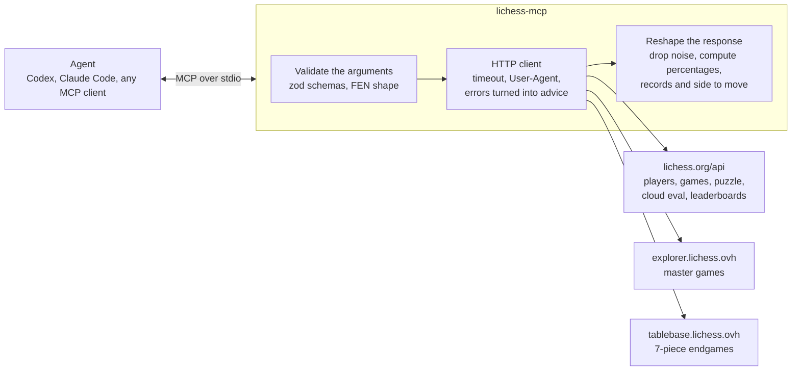

# lichess-mcp

[](https://github.com/jupiutrera/lichess-mcp/actions/workflows/ci.yml)
[](LICENSE)

An [MCP](https://modelcontextprotocol.io) server that gives a coding agent read-only access to public [Lichess](https://lichess.org) data: players, games, the daily puzzle, engine evaluations, opening statistics from master games and endgame tablebases. No account and no API key.

It comes with an eval: 20 questions put to an agent with and without the server, graded against the live API.

## The problem

Ask a model for a player's current rating, the engine's verdict on a position or the only move that draws an endgame, and it has three options: say it does not know, recall something stale, or work it out and sometimes get it wrong. All three are avoidable, because Lichess publishes the answers through a free API.

The API is not shaped for a model, though. A player profile comes with flairs, patron colours and rating deviations; games arrive as NDJSON; the tablebase reports each move from the opponent's side; engine scores are always from White's point of view; errors are an HTML page, a JSON object or plain text depending on the host. This server does that translation once, so the agent gets small results it can read and error messages it can act on.

## How it works



| Tool | What it answers |
|---|---|
| `get_player` | Title, rating and games in every time control, win/loss/draw record, when they joined |
| `get_recent_games` | A player's latest games with opponents, results and openings, and the record over them |
| `get_game` | One game by id or URL, with its moves |
| `get_daily_puzzle` | Today's puzzle: position, side to move, themes and solution |
| `get_cloud_eval` | Stockfish evaluation and best lines of a position, from the Lichess cloud database |
| `explore_masters` | How often a position occurred in master games, the results, and the most played moves |
| `probe_tablebase` | The perfect-play result of an endgame with 7 pieces or fewer, and what each move leads to |
| `get_leaderboard` | The top players of a time control or variant |

Every tool is read-only and declared as such (`readOnlyHint`), so a client can run it without asking. A call that fails comes back as a tool result with `isError` set and a sentence that says what to do: check the username, wait a minute after a rate limit, use `get_cloud_eval` when a position has too many pieces for the tablebase.

## Run it

Requires Node 22 or later.

```bash
git clone https://github.com/jupiutrera/lichess-mcp.git && cd lichess-mcp && npm install
```

`npm install` also builds the server into `dist/`. Then register it with your agent, replacing `/path/to` with the folder you cloned into.

**Codex**

```bash
codex mcp add lichess -- node /path/to/lichess-mcp/dist/index.js
```

or in `~/.codex/config.toml`:

```toml
[mcp_servers.lichess]
command = "node"
args = ["/path/to/lichess-mcp/dist/index.js"]
```

Then ask from a terminal:

```bash
codex exec "Who is first on the Lichess blitz leaderboard right now, and what do master games play most after 1. e4 c5 2. Nf3?"
```

**Claude Code**

```bash
claude mcp add lichess -- node /path/to/lichess-mcp/dist/index.js
```

**Without an agent**, to see the raw tool results against the live API:

```bash
npm run smoke
```

## Eval

`eval/cases.mjs` holds 20 questions of the kind a person would ask, covering the eight tools: a rating, a join date, a user that does not exist, a count over recent games, a move in a specific game, a two-step lookup, the daily puzzle, engine evaluations with and without the FEN given, opening statistics, four endgames and two leaderboards.

Each question is put to a headless agent twice: once with this server as its only tool and once with no tools at all. The agent ends with `ANSWER: <value>`, and that value is compared with the truth.

Three decisions in the design:

- **The grader does not use the server.** The expected answer is fetched from the Lichess API by separate code in the eval, so a bug in the server cannot grade itself as correct.
- **Live data is fetched before and after the agent answers** and both values are accepted, since a rating can change in between.
- **The agent may say it cannot know.** `ANSWER: UNKNOWN` and `ANSWER: NOT_FOUND` are allowed, which separates a model that has no way to look something up from one that invents a number.

### Results

Run on 27 November 2026 with Claude Code 2.1.332 as the agent. `sonnet` resolved to `claude-sonnet-5-5` and `haiku` to `claude-haiku-5-5`. One run per question and condition. Every answer, accepted value and tool call is in [`eval/results/`](eval/results).

| 20 questions | Sonnet 5.5, with the server | Sonnet 5.5, no tools | Haiku 5.5, with the server | Haiku 5.5, no tools |
|---|---|---|---|---|
| **Correct** | **20** | **5** | **20** | **2** |
| Said it could not know | 0 | 13 | 0 | 18 |
| Gave no answer | 0 | 2 | 0 | 0 |
| Wrong answer | 0 | 0 | 0 | 0 |
| Picked the expected tool | 20 | n/a | 20 | n/a |
| Tool calls | 20 | n/a | 21 | n/a |
| Median time per question | 5.3 s | 4.6 s | 4.5 s | 3.6 s |
| Cost of the 20 questions, as reported by the CLI | $0.16 | $0.18 | $0.013 | $0.014 |

What the numbers say:

- **With the server both models answered everything**, in one tool call per question (Haiku made one extra call). The one tool error in each run is the intended one: the user that does not exist returns a 404, and the agent answered `NOT_FOUND`.
- **Without tools the models got the endgames and little else.** Sonnet answered all four tablebase questions by calculating them, plus the title of a famous player; Haiku got two of the endgames. Neither invented a rating, a date or a game: given the option, they said they could not know.
- **The two "no answer" rows are a harness lesson.** Without tools, Sonnet gave no `ANSWER` line on two questions. One of those runs stalled until the 120 s limit killed it; run by hand, the same question made the model write a made-up shell command as text instead of an answer.
- **The eval is saturated.** 20 out of 20 for both models means it works as a regression check for the server and does not separate one model from another.

Reproduce with Claude Code installed and signed in:

```bash
npm run eval -- --model sonnet
```

The run writes every question, answer, accepted value and tool call to `eval/results/<model>.json`.

## Tests

```bash
npm test              # 38 tests, no network: a fake Lichess behind a real MCP client and server
npm run test:live     # one call per tool against the real API
```

The unit tests connect an MCP client to the server in memory and replace only `fetch`, so they cover the schemas, the reshaping and the error messages as an agent sees them. CI runs them on Linux and Windows with Node 22 and 24, then starts the built server over stdio and checks the handshake.

## Limitations

- **Opening statistics cover master games only.** The explorer of online Lichess games now answers 401 without a token, and this server has no authenticated mode.
- **Cloud evaluations exist only for positions someone analysed on Lichess.** Anything unusual returns an error, and the server does not run an engine of its own.
- **Tablebases stop at 7 pieces**, and mate distances exist only up to 5.
- **Read-only and public.** Nothing that needs an account: no private games, no puzzle history, no playing moves.
- **No request queue.** Lichess asks clients to make one request at a time. An agent that calls several tools in parallel can be rate limited; the server then tells it to wait a minute.
- **FEN checks are shallow.** They catch a wrong number of ranks or squares, not an illegal position.
- **The eval is small and ran once**: 20 questions, one run each, one agent harness (Claude Code) and two models from one provider. The answers without tools changed between runs during development. The Codex commands above follow the Codex documentation and were not part of the eval.
- **Most questions give the position as a FEN.** Only one asks the agent to work out the FEN from a list of moves, which is where a weaker model is most likely to slip.

## What I learned

- **The error message is part of the tool.** The tablebase answers HTTP 200 with every move marked "unknown" when a position has too many pieces. Passed through as is, that reads as a result. The server refuses before the network and names the tool that does work for that position.
- **An API's point of view is not the model's.** The tablebase labels each move with the outcome for the opponent, so the winning move arrives labelled "loss", and its distances are in plies, not moves. Both are converted and the fields are named after what they contain (`resultForMover`, `pliesToMate`).
- **The grader must not share code with what it grades.** The eval fetches the truth with its own requests. Using the server's own tools for that would have let a mistake in the perspective flip above pass as correct.
- **Live data needs a window, not a snapshot.** The daily puzzle's rating changed from 1767 to 1804 while this was being built. The eval reads the truth before and after each answer and avoids questions about values that drift by the minute.
- **Give the model a way to say it does not know.** With `UNKNOWN` available, no run without tools invented an answer; the failures were refusals, which is the behaviour an application can handle.
- **A headless agent needs a time limit.** One question without tools stalled two of the three times it was run. Without the limit the whole eval stops there.

## License

[MIT](LICENSE). Not affiliated with Lichess. The data belongs to Lichess and its players; see the [Lichess API terms](https://lichess.org/api).
